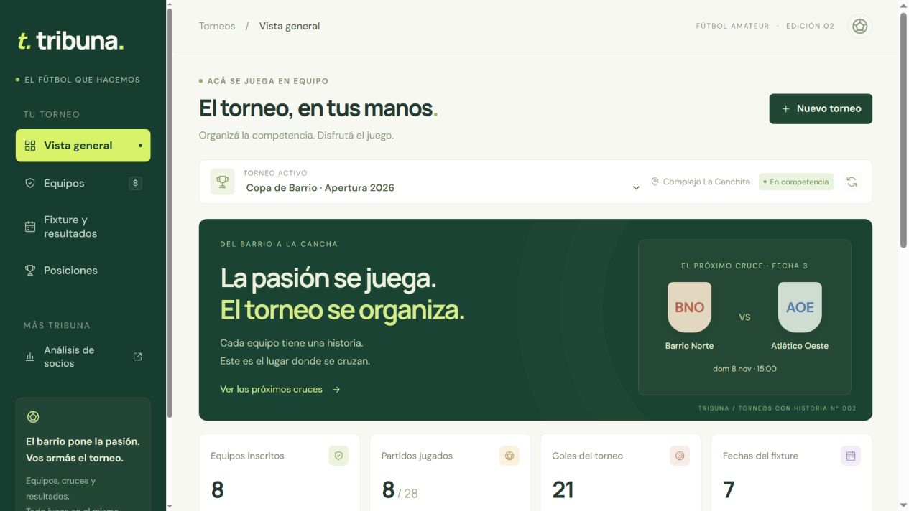

# Tribuna · Torneos con historia

Aplicación full stack para organizar torneos de fútbol amateur: desde la inscripción de equipos hasta el fixture, los resultados y la tabla de posiciones. Incluye un módulo de análisis de socios a partir de archivos CSV.

Interfaz propia, adaptable a escritorio y móvil, con Angular y Spring Boot. Desarrollada sin JHipster.



## Qué podés hacer

### Organizar un torneo

- Crear torneos con nombre, temporada y sede.
- Inscribir de 2 a 20 equipos, con nombre, abreviatura y color.
- Generar un fixture de todos contra todos a una rueda, con fechas libres para cantidades impares.
- Programar día, horario y cancha, con detección de reservas superpuestas.
- Cargar, corregir o quitar resultados; las posiciones se recalculan con cada cambio.
- Consultar puntos, partidos jugados, victorias, empates, derrotas, goles y forma reciente.
- Filtrar partidos por fecha y estado, y buscar equipos.

La primera ejecución crea **Copa de Barrio**, una demo con ocho equipos ficticios, siete fechas, 28 partidos y ocho resultados iniciales. La carga es idempotente: los cambios posteriores se conservan.

### Analizar una comunidad

El módulo **Análisis de socios** permite cargar un CSV, explorar estadísticas y consultar los últimos 20 análisis guardados:

- Total de socios, equipos y distribución de edades.
- Promedio de edad de socios de Racing.
- Hasta 100 socios casados con estudios universitarios, ordenados por edad.
- Los cinco nombres completos más frecuentes entre socios de River.
- Ranking de equipos por socios y edades promedio, mínima y máxima.
- Búsqueda, paginación y exportación del resumen por equipo.
- Demo reproducible con **2.480 socios ficticios**, disponible para descargar.

## Tecnologías

| Capa | Tecnologías |
|---|---|
| Frontend | Angular 22, TypeScript, RxJS, componentes standalone y signals |
| Backend | Java 21, Spring Boot 4.1.1, Spring MVC y Spring JDBC |
| Datos | PostgreSQL 17, transacciones y control de concurrencia |
| Archivos | Apache Commons CSV |
| Entorno | Docker Compose, Node 22 y Maven dentro de contenedores |
| Pruebas | JUnit y pruebas de integración con PostgreSQL |

## Ejecutar con Docker

Requisito: Docker Desktop iniciado, con contenedores Linux. No hace falta instalar Java, Node, Maven ni PostgreSQL en Windows.

Cloná el repositorio y ejecutá desde su carpeta:

```powershell
git clone https://github.com/cesararamayo3068/tribuna.git
cd tribuna
docker compose up -d
docker compose logs -f backend frontend
```

La primera ejecución descarga las imágenes y dependencias dentro de Docker. Esperá a que ambos servicios terminen de iniciar.

- Aplicación: [localhost:14202](http://localhost:14202/)
- Análisis de socios: [abrir módulo](http://localhost:14202/?modulo=analisis)
- Estado del backend y PostgreSQL: [localhost:18082/api/health](http://localhost:18082/api/health)

Para probar el flujo, abrí Copa de Barrio, consultá el fixture, editá un resultado y revisá cómo cambia la tabla. También podés crear tu propio torneo, inscribir equipos y generar sus cruces.

### Entorno y datos

Los contenedores son `tribuna-frontend`, `tribuna-backend` y `tribuna-postgres`, conectados por `tribuna-network`. PostgreSQL no publica un puerto en el equipo. Los datos, dependencias y cachés tienen volúmenes propios de Tribuna.

`.env.example` documenta la contraseña local de PostgreSQL. Docker Compose tiene un valor predeterminado para iniciar la demo; para personalizarlo, copiá el ejemplo a `.env` antes del primer inicio. `.env` queda excluido de Git.

```powershell
# Detener conservando los datos
docker compose stop

# Volver a iniciar
docker compose up -d

# Consultar logs
docker compose logs --tail 100 backend frontend

# Reiniciar el backend después de modificar Java
docker compose restart backend
```

Angular recarga los cambios del frontend automáticamente.

## Reglas de negocio

- Cada pareja de equipos se enfrenta una vez. Un equipo juega como máximo una vez por fecha.
- Generar el fixture cierra la inscripción; no se agregan ni retiran equipos después.
- Victoria: 3 puntos. Empate: 1. Derrota: 0. Desempates por diferencia de gol, goles a favor y nombre; UUID como último criterio estable.
- La forma reciente sigue el orden de fechas del fixture y muestra hasta cinco partidos.
- Un 0-0 es un empate. Quitar ambos goles devuelve el partido a pendiente y recalcula posiciones.
- Los goles son enteros entre 0 y 99; no se admiten resultados parciales ni decimales.
- Los nombres equivalentes por mayúsculas, tildes, espacios o puntuación se consideran duplicados dentro de un torneo.
- Horarios ingresados y mostrados en la zona del dispositivo, almacenados como instantes UTC. Una cancha o equipo reserva 90 minutos desde el inicio; se admite otro partido a los 90 minutos exactos.
- Transacciones y bloqueos protegen la inscripción, generación de fixture y reservas. La versión de cada partido permite detectar ediciones desactualizadas y responder HTTP 409.

## Formato de los archivos CSV

```csv
Nombre;Edad;Equipo;Estado Civil;Nivel de Estudios
Ana;31;Racing;Casada;Universitario
Juan;40;River;Casado;Secundario
```

Encabezado opcional; separador punto y coma; comillas CSV permitidas. Admite UTF-8 con o sin BOM y Windows-1252. Límite de 5 MB y 100.000 filas. Los cinco campos son obligatorios, de hasta 150 caracteres; la edad debe ser un entero de 0 a 120.

La importación se acepta completa o se rechaza con un mensaje de error. Los registros repetidos se cuentan por separado porque el formato no incluye un identificador. Se normalizan alias conocidos, como River Plate/River y Racing Club/Racing. Los nombres de River se cuentan usando el campo completo.

El CSV original no se conserva. Se guarda el análisis, incluido el listado de hasta 100 socios. La demo de análisis no se agrega al historial.

## API

### Torneos

| Método | Ruta | Función |
|---|---|---|
| GET / POST | `/api/tournaments` | Listar o crear torneos |
| GET | `/api/tournaments/{id}` | Consultar equipos, partidos y posiciones |
| POST | `/api/tournaments/{id}/teams` | Inscribir equipo |
| DELETE | `/api/tournaments/{id}/teams/{teamId}` | Retirar equipo antes del fixture |
| POST | `/api/tournaments/{id}/fixture` | Generar cruces una sola vez |
| PUT | `/api/tournaments/{id}/matches/{matchId}/result` | Guardar o quitar resultado |
| PUT | `/api/tournaments/{id}/matches/{matchId}/schedule` | Programar o quitar horario y cancha |

Los cambios de resultado y programación requieren la `version` recibida al consultar el partido. Para quitar un resultado, enviar ambos goles como `null`. Los horarios usan ISO 8601 con zona u offset.

### Socios y estado

| Método | Ruta | Función |
|---|---|---|
| GET | `/api/health` | Comprobar backend y conexión a PostgreSQL |
| GET | `/api/analyses/demo` | Consultar análisis de ejemplo |
| GET | `/api/sample.csv` | Descargar CSV ficticio |
| POST | `/api/analyses` | Importar multipart, campo `file` |
| GET | `/api/analyses` | Consultar los últimos 20 análisis |
| GET | `/api/analyses/{uuid}` | Recuperar análisis guardado |

Los errores de formato responden HTTP 400 con un mensaje; los archivos demasiado grandes, HTTP 413.

## Pruebas y compilación

La suite comprende **18 pruebas unitarias** y **8 pruebas de integración**. Verifica cálculos CSV, validaciones, fixture par e impar, posiciones, correcciones, persistencia, versiones y superposición de horarios.

Con los servicios iniciados:

```powershell
# Pruebas unitarias
docker compose exec backend mvn -B -ntp test

# Compilación de producción del frontend
docker compose exec frontend npm run build
```

Las pruebas de integración usan una base separada. Creala una sola vez:

```powershell
docker compose exec database psql -U tribuna -d postgres -c 'CREATE DATABASE tribuna_tournaments_test'
```

Luego ejecutá:

```powershell
docker compose run --rm --no-deps backend mvn -B -ntp test '-Dtest=TournamentServiceIT' '-Dspring.datasource.url=jdbc:postgresql://database:5432/tribuna_tournaments_test' '-Dtribuna.demo.enabled=false'
```

Cada prueba de integración revierte sus datos mediante transacción. Las opciones `-D` están entre comillas para funcionar en PowerShell.

## Estructura

```text
tribuna/
├── backend/          API, reglas de negocio, SQL y pruebas
├── frontend/         Aplicación Angular y estilos
├── docs/images/      Captura de la aplicación
├── compose.yaml      Entorno Docker independiente
└── .env.example      Configuración local de ejemplo
```

## Estado del proyecto

Versión de demostración local con datos ficticios, sin autenticación y con historial compartido por instancia. Incluye gestión de torneos y análisis de socios. Jugadores, goleadores individuales, tarjetas, sanciones, eliminatorias, cuentas y despliegue público quedan para futuras iteraciones.

Proyecto personal de [César Aramayo](https://github.com/cesararamayo3068), iniciado a partir de una consigna de análisis de socios y ampliado con gestión de torneos e identidad visual propia.
